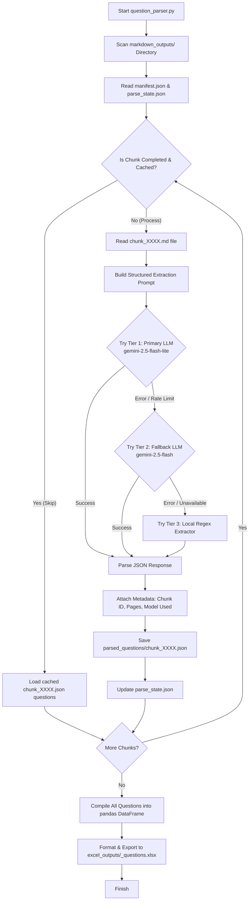

# Question Parser Workflow & Code Syntax Documentation (`question_parser.py`)

This document provides a complete technical explanation of the architecture, workflow, and line-by-line code syntax of `question_parser.py`.

---

## 🔄 End-to-End Workflow Diagram



---

## 📋 Detailed Step-by-Step Workflow

### Step 1: Document & Manifest Scanning
- The parser inspects `markdown_outputs/` and detects document folders (e.g. `arihant-general-studies`).
- It loads `manifest.json`, which contains the list of all PDF chunks, their sequence numbers, and page ranges (`page_start`, `page_end`).

---

### Step 2: Resumable State & Cache Inspection
- Loads `parse_state.json` inside the document folder.
- For every `chunk_XXXX`, it checks if `parsed_questions/chunk_XXXX.json` exists and is marked as `"completed"`.
- If already parsed, it **skips calling the LLM** and loads the questions directly from disk in milliseconds.

---

### Step 3: Markdown Chunk Ingestion
- If a chunk needs processing, `question_parser.py` reads `markdown_outputs/<doc_id>/chunks/chunk_XXXX.md`.
- Extract page boundary markers (`<!-- PAGE: X -->`) and relational YAML front matter.

---

### Step 4: Prompt Construction
- Constructs a zero-shot prompt requesting strict JSON format with fields:
  - `question_text`
  - `option_a`, `option_b`, `option_c`, `option_d`
  - `correct_option`
  - `explanation`
  - `subject`, `topic`

---

### Step 5: 3-Tier Resilient Fallback Execution
The parser executes a cascading fallback strategy:

1. **Tier 1 (Primary Model)**: Sends request to `gemini-2.5-flash-lite`.
2. **Tier 2 (Fallback Model)**: If Tier 1 throws an API error, rate limit (429), or invalid payload, it automatically retries with `gemini-2.5-flash`.
3. **Tier 3 (Local Regex Extractor)**: If external LLMs are unreachable or offline, it runs a regex engine that detects question numbers, options `A.`, `B.`, `C.`, `D.`, and extracts them offline.

---

### Step 6: JSON Cleaning & Normalization
- Removes markdown backticks (```json ... ```).
- Uses `json5` for resilient parsing (handles trailing commas, unquoted keys, single quotes).
- Enriches every extracted question object with metadata:
  ```json
  {
    "document_id": "arihant-general-studies",
    "chunk_id": "chunk_0001",
    "page_start": 1,
    "page_end": 5,
    "model_used": "Primary LLM (gemini-2.5-flash-lite)",
    "question_text": "...",
    "option_a": "...",
    "option_b": "...",
    "option_c": "...",
    "option_d": "...",
    "correct_option": "A",
    "explanation": "...",
    "subject": "History",
    "topic": "Ancient India"
  }
  ```

---

### Step 7: Real-Time Incremental Saving
- Writes enriched questions to `markdown_outputs/<doc_id>/parsed_questions/chunk_XXXX.json`.
- Updates `parse_state.json` with timestamp, question count, and strategy used.
- Ensures zero data loss if execution is paused or interrupted.

---

### Step 8: Excel Workbook Compilation & Formatting
- Once all document chunks are processed, the pipeline merges all chunk JSON files into a single `pandas` DataFrame.
- Auto-generates standardized Question IDs (`QST_00001`, `QST_00002`, ...).
- Uses `openpyxl` to write `excel_outputs/<doc_id>_questions.xlsx` with custom column widths and formatted headers.

---

## 🐍 Full Python Code Syntax Breakdown (`question_parser.py`)

### 1. Environment & Import Setup (Lines 1–61)
```python
import os, sys, time, json, json5, re, logging
from pathlib import Path
from typing import List, Dict, Any, Optional
import pandas as pd
import requests
```
- **`pathlib.Path`**: Used for cross-platform object-oriented filesystem paths (`CURRENT_DIR / "markdown_outputs"`).
- **`sys.stdout.reconfigure(encoding="utf-8")`**: Prevents `UnicodeEncodeError` crashes on Windows terminals.
- **`json5`**: A lenient JSON parser capable of parsing LLM responses containing trailing commas or syntax glitches.
- **`pandas` & `requests`**: `requests` handles HTTP REST calls to Gemini APIs; `pandas` formats and outputs Excel files.

---

### 2. Tier 3: Local Regex Fallback Extractor (Lines 66–113)
```python
def regex_extract_questions(text: str) -> List[Dict[str, Any]]:
```
- **Syntax Purpose**: Offline regex parser to extract questions if LLM APIs are down or unauthenticated.
- **Pre-cleaning**: Standardizes option variations like `(A)`, `a)`, `( a )` into uniform `A.` markers using `re.sub()`.
- **Regex Pattern**:
  ```regex
  (\d{1,4})\s*[\.\)]\s*(.*?)\s*[Aa]\s*[\)\.:]\s*(.*?)\s*[Bb]\s*[\)\.:]\s*(.*?)\s*[Cc]\s*[\)\.:]\s*(.*?)\s*[Dd]\s*[\)\.:]\s*(.*?)(?=\s*\d{1,4}\s*[\.\)]|\Z)
  ```
  Matches: Question Number, Question Text, Option A, Option B, Option C, Option D up to the next question boundary.

---

### 3. Tier 1 & 2: `QuestionExtractor` & Fallback Engine (Lines 116–179)
```python
class QuestionExtractor:
    def __init__(self):
        ...
    def _call_gemini_rest_api(self, model_name: str, prompt: str) -> Optional[str]:
        ...
    def generate_with_fallback(self, prompt: str, chunk_text: str) -> tuple[List[Dict[str, Any]], str]:
```
- **`_call_gemini_rest_api()`**: Performs an HTTP POST to Google's REST Endpoint `https://generativelanguage.googleapis.com/v1beta/models/{model_name}:generateContent?key={API_KEY}` with a 60s timeout.
- **`generate_with_fallback()`**:
  - Executes **Attempt 1**: Calls `PRIMARY_MODEL` (`gemini-2.5-flash-lite`).
  - Executes **Attempt 2**: If Attempt 1 fails, calls `FALLBACK_MODEL` (`gemini-2.5-flash`).
  - Executes **Attempt 3**: If LLM API fails or has no key, delegates execution to `regex_extract_questions(chunk_text)`.

---

### 4. JSON Cleaning Utility (Lines 181–209)
```python
def clean_and_parse_json(raw_text: str) -> List[Dict[str, Any]]:
```
- **Syntax Purpose**: Cleans markdown formatting backticks (` ```json ... ``` `) and extracts the raw JSON array string using `.find("[")` and `.rfind("]")`.
- Passes the cleaned payload to `json5.loads()` to convert raw string to Python list/dictionary objects.

---

### 5. Structured Prompt Generator (Lines 212–241)
```python
def build_question_prompt(chunk_markdown: str, page_start: int, page_end: int) -> str:
```
- **Syntax Purpose**: Builds an explicit prompt instructing the LLM to return a strict JSON array of objects representing all MCQs within the current page range slice.

---

### 6. Pipeline Orchestrator & Resumable State (Lines 244–371)
```python
class RelationalQuestionParserPipeline:
    def process_document(self, doc_dir: Path):
```
- **Resumable State Check**:
  ```python
  if parse_state.get(chunk_id, {}).get("status") == "completed" and chunk_json_out.exists():
      # Skip LLM call and load cached json
  ```
- **Metadata Enrichment**:
  Iterates over returned question objects and attaches relational identifiers:
  `document_id`, `chunk_id`, `page_start`, `page_end`, and `model_used`.
- **State Persistence**:
  Saves chunk questions to `parsed_questions/chunk_XXXX.json` and records metadata in `parse_state.json`.

---

### 7. Excel Generation & Formatting (Lines 372–416)
```python
def _export_to_excel(self, doc_id: str, questions: List[Dict[str, Any]]):
```
- **`pd.DataFrame(rows)`**: Converts list of question dictionaries into a tabular pandas DataFrame.
- **`pd.ExcelWriter(excel_filename, engine="openpyxl")`**: Writes DataFrame into Excel worksheet named `"Questions"`.
- **Column Width Auto-Fit**:
  Iterates through Excel columns and sets `worksheet.column_dimensions[col_letter].width` based on maximum content length to ensure neat visual alignment.

---

### 8. Script Entry Point (Lines 428–431)
```python
if __name__ == "__main__":
    pipeline = RelationalQuestionParserPipeline()
    pipeline.run_all()
```
- Ensures the parser can be executed directly from terminal via `python question_parser.py` or imported as a module in other services.

---

## 📊 Final Excel Output Schema

| Column Name | Description | Example Value |
|---|---|---|
| `Question ID` | Unique auto-generated ID | `QST_00001` |
| `Document ID` | Unique Document Identifier | `arihant-general-studies` |
| `Chunk ID` | Origin Chunk Identifier | `chunk_0001` |
| `Page Start` | Start Page of Chunk | `1` |
| `Page End` | End Page of Chunk | `5` |
| `Question Text` | Question Statement | `Who was the founder of the Maurya Empire?` |
| `Option A` | Choice A | `Chandragupta Maurya` |
| `Option B` | Choice B | `Ashoka` |
| `Option C` | Choice C | `Bindusara` |
| `Option D` | Choice D | `Harsha` |
| `Correct Option` | Correct Option Letter | `A` |
| `Explanation` | Detailed Answer / Solution | `Chandragupta Maurya founded the empire in 322 BCE.` |
| `Subject` | Inferred Subject | `History` |
| `Topic` | Inferred Topic/Chapter | `Ancient India` |
| `Extraction Model` | Model or Fallback Strategy | `Primary LLM (gemini-2.5-flash-lite)` |
